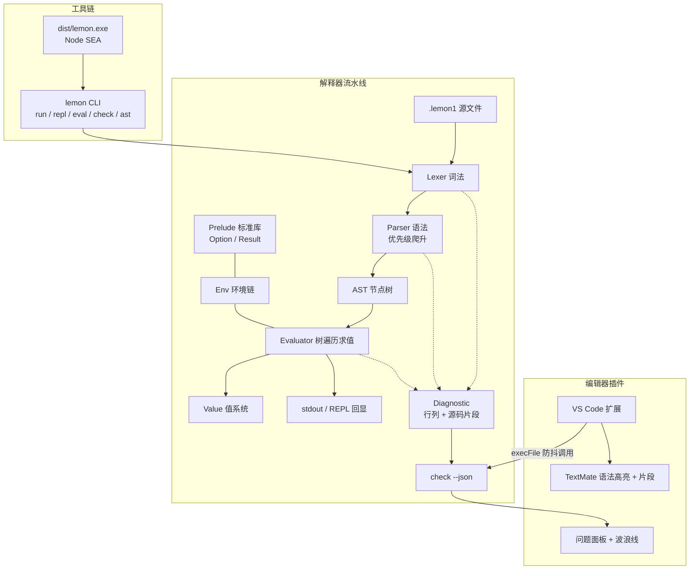

## 产品概述

Lemon 是一门全新设计的函数式编程语言，源文件后缀为 `.lemon1`。它以"不可变、函数是一等公民、模式匹配、管道式数据流"为核心，语法精简、报错清晰，追求"写得少、看得懂、跑得起来"。交付三件套：可直接运行的命令行可执行程序（既能跑脚本文件，也能进入交互式解释环境）、编辑器插件（语法高亮 + 实时错误提示），以及一份让 AI 助手能读写 Lemon 代码的技能包。用户在全新空目录中从零开始，无历史代码包袱。

## 核心功能

**语言内核**

- 词法与语法：行/块注释，数字、字符串、布尔、Unit 字面量；绑定、函数、条件、匹配、类型声明、导入等语句，语句以换行或分号分隔
- 不可变绑定：`let` 绑定的值不可重新赋值；绑定天然支持自引用，因此递归函数无需额外关键字
- 一等函数：函数可作为参数、返回值、存入列表；支持闭包捕获与柯里化
- 代数数据类型与模式匹配：用 `type` 声明构造器；`match` 支持通配、变量绑定、字面量、元组、列表（含首尾拆分与连接符写法）、构造器以及卫语句；内建 Option / Result
- 数据管道与标准库：管道操作符把左侧值作为第一个实参传入，配合列表（map/filter/fold/sort/take 等）、字符串、数值、输入输出等常用函数，形成线性可读的数据流
- 运算重载：`+` 同时支持数字相加、字符串拼接、列表连接

**运行与交互**

- 直接运行 `.lemon1` 脚本；单行求值；REPL 逐行输入并保留上文绑定；仅做语法检查模式
- 退出码区分：成功为 0，语言错误为 1，用法错误为 2

**错误反馈（视觉与交互效果）**

- 编译期错误：在终端以"错误码 + 中文说明 + 行列位置 + 带箭头的源码定位片段"三段式输出，一眼定位问题
- 运行期错误：额外打印 Lemon 层调用栈（函数名 + 位置），不暴露宿主内部堆栈；递归过深给出友好提示而非崩溃
- 程序正常输出与错误信息分流，互不污染

**编辑器支持**

- `.lemon1` 文件语法高亮（关键字、构造器、字符串、注释、运算符、数字）
- 括号自动配对、注释快捷切换、代码片段（let / fn / match / type / if）
- 输入或保存时自动调用解释器做语法检查，错误实时显示在编辑器问题面板并下划线标记

**交付形态与分期（待你确认）**

- 第一档（本方案默认交付）：上述全部语言内核能力 + 标准库 + REPL + 可执行文件 + 编辑器插件 + 文档与示例集
- 第二档（后续可选）：记录/映射类型、字符串插值、模块与多文件导入、尾调用优化、范围与推导式、完整语言服务器（补全/跳转定义）
- 第三档（远景）：字节码虚拟机、宏系统、静态类型推导

## 技术栈选型

| 层面 | 选型 | 说明 |
| --- | --- | --- |
| 宿主语言 | TypeScript 5.x | 用户最终选择；Node 22 已具备，零安装成本 |
| 运行时 | Node.js 22（engines >= 20） | 解释器运行环境，同时作为可执行文件打包基底 |
| 构建 | esbuild（bundle 成单文件 CJS）+ tsc（`--noEmit` 类型检查） | esbuild 构建快，且产出满足单文件要求 |
| 可执行文件 | Node SEA（Single Executable Application）+ postject | Node 官方方案，产物 `lemon.exe` 独立运行，无第三方二进制补丁链 |
| 测试 | 内置 `node:test` + `tsx`（直跑 TS）+ 自建 fixtures 黄金测试 | 运行时零依赖，依赖全部集中在开发期 |
| 编辑器插件 | VS Code Extension API + TextMate 语法 + `@vscode/vsce` | 语法高亮 + 诊断 Provider |
| 运行时依赖 | **无** | 仅 devDependencies：typescript、esbuild、tsx、postject、@vscode/vsce |


## 实现方案

### 总体策略

实现一条经典的**前端流水线**：源码 → 词法（Lexer）→ 语法（Parser，优先级爬升）→ AST → 树遍历求值器（Evaluator）。四层严格单向依赖，每层可独立单测。语言语义按"函数式 + 动态类型"设计：不可变、值语义、函数一等公民、模式匹配驱动控制流。

### 关键决策与权衡

1. **单文件 bundle + Node SEA，而非 pkg/nexe**：Node 22 原生支持 SEA，产物小、无额外二进制补丁链，也不存在第三方打包器对新 Node 版本滞后的问题。代价是 SEA blob 与 Node 主版本绑定——升级 Node 后必须重新执行打包。
2. **管道 `|>` 采用"左侧值作为第一个实参"（Elixir 风格）**：使 `nums |> filter(p) |> map(f) |> fold(0, g)` 完全线性可读；由此统一全部标准库的"数据在前"参数约定，不需要区分柯里化顺序，规则远比 F# 风格简单。
3. **`let` 默认递归，不引入 `rec` 关键字**：绑定求值时先把名字以占位符写入当前环境，再求值右值，函数体即可自引用。少一个关键字、少一条语法规则，递归能力不减。
4. **动态类型 + 运行期 ADT 标签**：值以带 `tag` 的联合类型表示，`Option`/`Result` 由 prelude 预置为内建 ADT，用户也可用 `type` 声明自有 ADT。v1 放弃静态类型推导，换取实现复杂度与报错友好度的平衡；类型推导列为远景。
5. **编辑器诊断复用 CLI 而非自建 LSP**：插件在 `didOpen`/`didChange` 时防抖调用 `lemon check --json <file>`，直接复用解释器自身的词法与语法层作为唯一事实来源（DRY），实现成本极低、行为永远与解释器一致。完整 LSP 列入第二档。
6. **零运行时依赖**：解释器分发形态是单个 `.exe`/单文件，不引入任何 npm 运行时包，与既有项目一贯的"零第三方依赖"风格保持一致。

### 性能与可靠性

- **Lexer**：手写字符扫描（`charCodeAt` + 索引游标），单趟 O(n)，不逐 token 用正则回溯；关键字识别走 `Map` 查表，避免重复 `substring` 分配。
- **Parser**：单趟优先级爬升，无回溯，O(n)。错误时构造 `span{start,end,line,col}` 抛首个错误；错误恢复留待第二档。
- **Evaluator**：环境为 `Env{ vars: Map<string, Value>, parent }` 链式结构，查找 O(作用域深度)。prelude 环境全局创建一次、只读共享，避免每次函数调用重建内建表。AST 求解为单次后序遍历，O(节点数)。
- **递归深度防护**：显式维护 Lemon 层调用深度计数，超限抛领域错误；同时捕获宿主 `RangeError`（Maximum call stack size exceeded）转译为"递归层数过深"的友好提示，绝不向用户暴露宿主堆栈。尾调用优化列入第二档。
- **值语义保证**：内建列表函数一律返回新数组，绝不原地修改入参，确保不可变语义不被标准库破坏；列表 `+` 连接同样产出新数组。
- **输出通道隔离**：程序输出走 stdout，诊断与错误走 stderr；`--check --json` 保证 stdout 上只有一份合法 JSON，便于插件稳定解析。解释器自身不打印任何日志，错误信息含行列与源码片段但绝不 dump 大对象。
- **REPL 体验**：跨行共享同一 Env，使后一行能引用前一行绑定；多行输入（未闭合括号/未结束的 match）自动续行等待，不误报语法错误。

### 兼容性与影响面

均为全新空仓库，无向后兼容约束与历史包袱。唯一强环境约束是 Windows + Node 22；SEA 打包产物仅限 Windows/x64，跨平台需在目标平台各跑一次打包脚本。

## 架构设计



## 目录结构

```
e:/lemon/
├── package.json                    # [NEW] 项目清单：bin 指向 lemon、scripts（build/test/dev/dist:exe）、devDependencies、engines>=20
├── tsconfig.json                   # [NEW] TS 编译配置：ES2022 / NodeNext / strict / noEmit（仅类型检查）
├── .gitignore                      # [NEW] 忽略 node_modules、dist、out、*.vsix、sea-prep.blob
├── README.md                       # [NEW] 项目简介、安装、快速上手三行示例、构建与打包命令
├── bin/
│   └── lemon.js                    # [NEW] 可执行入口（shebang），require('../dist/cli.js')；供 npm link 全局使用
├── src/
│   ├── index.ts                    # [NEW] 库入口，导出 lex/parse/evaluate/runSource 等公共 API 供测试与外部调用
│   ├── cli.ts                      # [NEW] CLI 入口：解析 argv，分派 run/repl/eval/check/ast 子命令，统一退出码与 stderr 输出
│   ├── repl.ts                     # [NEW] REPL：readline 循环、多行续行判定、跨行共享 Env、表达式回显、Ctrl+C 优雅退出
│   ├── runtime/
│   │   ├── token.ts                # [NEW] TokenKind 枚举、Token 类型、关键字与运算符映射表
│   │   ├── lexer.ts                # [NEW] 手写字符扫描器：单趟 O(n)，支持注释/字符串转义/数字指数，产出带 span 的 Token 流
│   │   ├── ast.ts                  # [NEW] AST 节点类型联合（Expr/Stmt/Pattern/TypeDecl），全部携带 span 供报错定位
│   │   ├── parser.ts               # [NEW] 优先级爬升解析器：按优先级表处理二元运算与一元运算，支持 match 分支、卫语句、类型声明
│   │   ├── value.ts                # [NEW] Value 联合类型（Number/String/Bool/Unit/Tuple/List/Closure/Adt）+ 相等、真值、Lemon 文本化显示
│   │   ├── env.ts                  # [NEW] 环境链：Map + parent 指针，define/lookup/占位符（支持 let 自递归）
│   │   ├── pattern.ts              # [NEW] 模式匹配引擎：通配/变量/字面量/元组/列表首尾/构造器/卫语句，返回绑定表或失败
│   │   ├── eval.ts                 # [NEW] 树遍历求值器：表达式与语句求值、闭包构造与调用、管道、递归深度防护、调用栈收集
│   │   ├── prelude.ts              # [NEW] 标准库：IO/数值/字符串/列表/高阶函数，内建 Option 与 Result 构造器
│   │   ├── errors.ts               # [NEW] LemonError（code + span + 消息 + 调用栈）与错误码常量（E0xx 词法 / E1xx 语法 / E2xx 运行期）
│   │   ├── diagnostics.ts          # [NEW] 诊断渲染：带行号与 ^ 指示的源码片段文本渲染，以及 --check --json 的 JSON 序列化
│   │   └── printer.ts              # [NEW] AST 格式化输出，支撑 --ast 子命令与测试快照
│   └── utils/
│       ├── args.ts                 # [NEW] 轻量 argv 解析：子命令、flag、文件路径，非法用法返回用法错误
│       └── source.ts               # [NEW] 源码读取、offset↔line/col 换算、按行切分缓存
├── tests/
│   ├── lexer.test.ts               # [NEW] Token 流断言：注释、数字、字符串转义、非法字符、行列定位
│   ├── parser.test.ts              # [NEW] AST 结构断言与优先级正确性、错误场景定位断言
│   ├── eval.test.ts                # [NEW] 求值语义：不可变绑定、闭包捕获、递归、管道、match 全模式、错误与调用栈
│   ├── builtins.test.ts            # [NEW] 标准库逐个函数 + 重载运算 + 值语义（入参不被修改）断言
│   ├── cli.test.ts                 # [NEW] 子进程级断言：run/eval/check --json 的 stdout、stderr 与退出码契约
│   ├── fixtures.test.ts            # [NEW] 黄金用例驱动器：扫描 fixtures 目录，执行 .lemon1 并比对 .out
│   └── fixtures/                   # [NEW] *.lemon1 输入与同名 *.out 期望输出，覆盖递归/ADT/管道/错误边界
├── examples/
│   ├── hello.lemon1                     # [NEW] 最小入门示例
│   ├── recursion.lemon1                 # [NEW] 阶乘、斐波那契、累加
│   ├── adt_match.lemon1                 # [NEW] 自定义 ADT + 模式匹配
│   ├── pipeline.lemon1                  # [NEW] 管道 + 标准库数据流示例
│   └── fizzbuzz.lemon1                  # [NEW] 综合示例
├── scripts/
│   ├── build.mjs                   # [NEW] esbuild 打包：产出 dist/lemon.cjs（SEA 用）与 dist/cli.js（npm bin 用）
│   ├── make-exe.mjs                # [NEW] Node SEA 全流程：生成 sea-config.json → sea-prep.blob → 复制 node.exe → postject 注入 → dist/lemon.exe
│   └── sea-config.json             # [NEW] SEA 配置：main 指向 dist/lemon.cjs，output 为 blob
├── docs/
│   ├── spec.md                     # [NEW] 语言规范：词法、语法（EBNF）、优先级表、语义、标准库签名、错误码表
│   ├── tutorial.md                 # [NEW] 由浅入深教程，围绕 examples 展开
│   └── architecture.svg            # [NEW] 架构图（由架构图技能产出，供文档引用）
└── vscode-lemon/
    ├── package.json                # [NEW] 扩展清单：contributes.languages（.lemon1）、grammars、snippets、commands（run/openRepl）、configuration（lemon.executablePath）
    ├── tsconfig.json               # [NEW] 扩展编译配置，输出 to out/
    ├── language-configuration.json # [NEW] 括号配对、自动闭合、行/块注释符号
    ├── syntaxes/lemon.tmLanguage.json # [NEW] TextMate 语法：关键字、构造器、字符串、注释、数字、运算符分组着色
    ├── snippets/lemon.json         # [NEW] 片段：let / fn / match / type / if / pipe
    ├── src/extension.ts            # [NEW] 激活入口：注册诊断集合、防抖调用 lemon check --json、注册运行命令并在终端执行
    └── README.md                   # [NEW] 插件安装（从 VSIX 安装）与配置说明
```

## 语言规范要点

### 词法

- 注释：`// 行注释`、`/* 块注释 */`
- 标识符：`[A-Za-z_][A-Za-z0-9_]*`；约定构造器首字母大写以区分普通绑定
- 字面量：数字（f64，支持小数与指数）、字符串（双引号，支持 `\n`、`\t`、`\\`、`\"`、`\u{...}`）、`true` / `false`
- 关键字：`let` `fn` `if` `then` `else` `match` `type` `import` `true` `false`

### 优先级（低 → 高）

管道 → 逻辑或 → 逻辑与 → 比较 → 连接（右结合） → 加减 → 乘除取余 → 一元（负号、取非） → 调用与索引

### 语句与表达式

- 语句：`let 名 = 表达式`、`type 名 = 构造器(字段...) | 构造器 | ...`、`import "路径"`、表达式语句
- 语句边界：换行或分号，解析器按"表达式后无法继续"的 token 判定，无需强制分号
- 函数：`fn(参数, ...) => 表达式`，支持闭包与柯里化
- 条件：`if 条件 then 表达式 else 表达式`（本身是表达式，可嵌套）
- 匹配：`match 值 { 模式 [if 守卫] => 表达式; ... }`
- 模式：`_`、变量、字面量、`(p1, p2)`、`[p1, p2]`、`[h, ...t]`、`h :: t`、`构造器(p...)`、`构造器`

### 值类型

Number（f64 统一数值） / String / Bool / Unit / Tuple / List / Function（闭包：参数 + 函数体 + 捕获环境） / Adt（tag + payload）

### 标准库（数据在前，便于管道）

- 输入输出：`print` `println` `readLine`
- 数值：`abs` `min` `max` `floor` `ceil` `round` `sqrt` `pow`
- 字符串：`len` `str` `num` `upper` `lower` `trim` `split` `join` `contains` `replace` `chars`
- 列表：`map` `filter` `fold` `sum` `head` `tail` `length` `range` `concat` `zip` `reverse` `sort` `take` `drop` `any` `all` `flatMap`
- 运算重载：`+` 数字相加 / 字符串拼接 / 列表连接（类型不匹配给出提示改用 `str`）；`::` 列表前插

### 示例程序（同时作为语法契约）

```
// examples/pipeline.lemon1
type Option = Some(value) | None

let fact = fn(n) =>
  if n <= 1 then 1 else n * fact(n - 1)

let safeDiv = fn(a, b) =>
  if b == 0 then None else Some(a / b)

let describe = fn(o) => match o {
  Some(v) => "结果 = " + str(v)
  None    => "无法计算"
}

let total = [1, 2, 3, 4, 5]
  |> filter(fn(x) => x % 2 == 1)
  |> map(fn(x) => x * x)
  |> fold(0, fn(acc, x) => acc + x)

println(describe(safeDiv(10, 2)))   // 结果 = 5
println(str(total))                 // 35
println(str(fact(5)))               // 120
```

### CLI 契约

```
lemon                     进入 REPL（跨行保留绑定）
lemon run file.lemon1          运行脚本
lemon file.lemon1              等价于 run（简写）
lemon eval "1 + 2"        求值单行表达式
lemon check --json f.lemon1    仅做词法/语法检查，stdout 输出 JSON 诊断
lemon ast f.lemon1             打印 AST（调试）
lemon --version / --help  版本与帮助
```

退出码：`0` 成功；`1` 语言错误（编译期或运行期）；`2` 用法错误。

`--check --json` 输出契约（编辑器插件依赖，必须长期稳定）：

```
{ "ok": true, "diagnostics": [] }
```

```
{
  "ok": false,
  "diagnostics": [
    { "severity": "error", "code": "E0102", "message": "字符串未闭合",
      "line": 3, "col": 5, "endLine": 3, "endCol": 9 }
  ]
}
```

### 错误码分层

- `E0xx` 词法错误（非法字符、字符串/注释未闭合、非法数字）
- `E1xx` 语法错误（意外的 token、缺少 `then`/`else`、match 分支缺失、模式重复）
- `E2xx` 运行期错误（未定义变量、类型不匹配、除以零、模式匹配非穷尽、递归过深）

### 可执行文件打包要点

- 顺序：esbuild 打包 `dist/lemon.cjs` → 依 `sea-config.json` 生成 `sea-prep.blob` → 复制 `node.exe` 为 `dist/lemon.exe` → `postject` 注入 blob（必须使用与 Node 版本一致的 SEA fuse 名）
- 打包脚本需在覆盖 `dist/lemon.exe` 前先结束同名进程（Windows 文件占用），并对每一步做失败即停与清晰报错
- 产物验证：在无 node 环境变量依赖下执行 `lemon.exe run examples/pipeline.lemon1`，比对输出与退出码

## Agent Extensions

### Skill

- **编程专家.Skill**
- Purpose: 在解释器内核（求值器、模式匹配、环境链、递归防护）与 CLI 契约实现阶段提供 P8 级工程纪律与代码质量把关，包括 API 设计、错误处理、边界条件与测试策略审视
- Expected outcome: 产出一份可维护、错误处理完善、测试覆盖到位的解释器内核，并附代码审查要点与潜在缺陷清单

- **架构图一键生成**
- Purpose: 依据最终落地的目录结构、模块依赖与数据流，生成 Lemon 语言的架构图（SVG）与语言特性思维导图，作为 `docs/architecture.svg` 文档资产
- Expected outcome: 产出可嵌入文档的架构图文件，准确反映四层流水线（词法→语法→AST→求值器）与工具链（CLI / SEA / 编辑器插件）的关系

- **skill-creator**
- Purpose: 生成一份 CodeBuddy 的 Lemon 语言技能包，包含语言语法速查、常用惯用法、标准库签名与错误码说明，使 AI 助手能正确编写与解释 `.lemon1` 代码
- Expected outcome: 产出一份结构规范的 SKILL.md 技能定义与配套参考文件，内容与已实现的解释器行为完全一致，可被实际加载使用