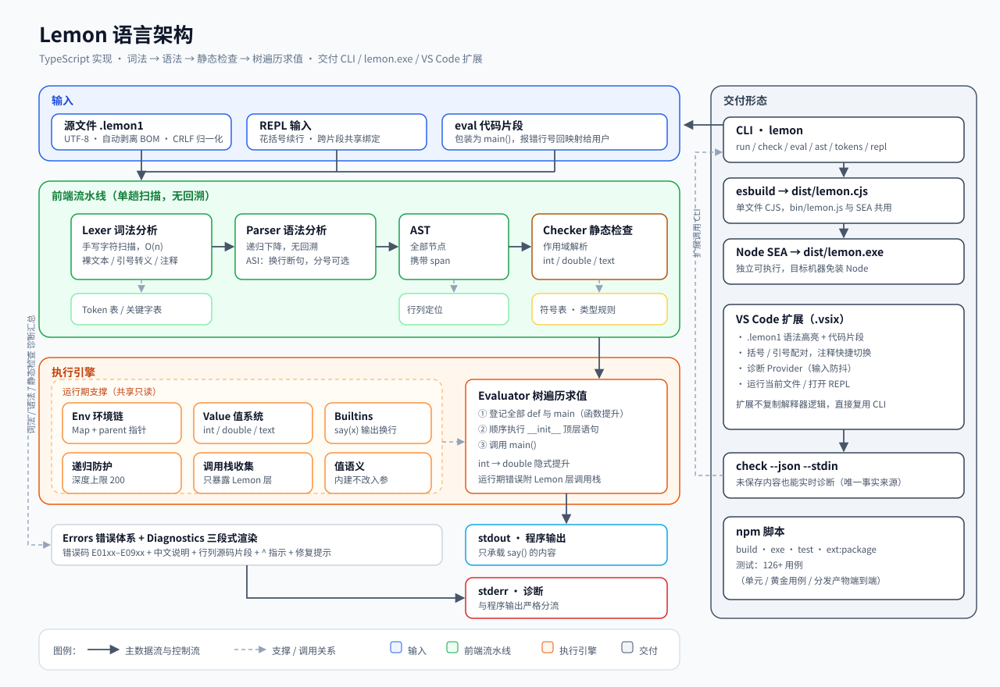

# Lemon

一门用 TypeScript 从零实现的**命令式编程语言**，源文件后缀 `.lemon1`。

设计目标只有三条：**壳子固定、类型明确、写起来顺**。

```lemon
__init__ {
    int count = 3
    double price = 12.5
    text name = Lemon
    bool 有货 = count > 0

    def greet(who) {
        say(你好)
        say(who)
    }

    def 报价() {
        if price < 10 {
            say(便宜)
        } elif price < 100 {
            say(适中)
        } else {
            say(昂贵)
        }
    }

    main() {
        say(count + 1)              // 4
        say(price / 4)              // 3.125
        say(1 + 2 * 3)              // 7
        say(-count)                 // -3
        say(name + 语言)             // Lemon语言
        say(有货 && price < 100)     // true
        greet(小明)
        报价()
    }
}
```

```
$ lemon examples/hello.lemon1
你好，世界
```

## 语言速览

| 项目 | 规定 |
| --- | --- |
| 源文件 | 后缀 **`.lemon1`**，UTF-8（BOM 自动剥离），换行 LF / CRLF 都认 |
| 入口 | `__init__ { ... }` 是**必需**外壳；`main()` 在其中声明主程序，**不写 `def`** |
| 变量 | 声明必须带类型：`int a = 1`、`double b = 1.23`、`text c = 你好`、`bool ok = true` |
| 类型检查 | **静态检查**：`int a = 你好` 在运行前就会报错；`int` 可隐式提升为 `double` |
| 运算 | `+ - * /` 与括号；`*` `/` 优先于 `+` `-`，同级左结合；`int / int` 向零截断；`+` 还能拼接文本 |
| 乘方 | `**` 优先级最高且右结合：`2 ** 3 ** 2` = `512`，`-2 ** 2` = `-4`；`int ** int` 保持 int（指数须非负） |
| 正负号 | 一元 `-` / `+`：`-1`、`+5`、`-x`、`-(a + b)`；优先级高于 `*` `/`；`+` 是数值恒等 |
| 比较 | `== != < <= > >=`，结果固定是 `bool`；数字之间（含 `int`/`double` 混用）可比较大小，`text` 与 `bool` 只能判断相等 |
| 逻辑 | `&&` `||` 短路求值、`!` 取反；两侧都必须是 `bool`，所以 `if a` 会报错，要写 `if a != 0` |
| 条件分支 | `if 条件 { ... } elif 条件 { ... } else { ... }`；条件**不写括号**，分支体各自独立作用域 |
| 循环 | `cycle(N) { ... }` 重复 N 次，体内 `i` 从 0 递增；`cycle() { ... }` 是无限循环，用 `break` 跳出 |
| 键盘 | `keyboard(w)` 非阻塞判定（读过即清零）；`waitKey(w)` 阻塞等待。键名：单字符或 `space`/`enter`/`esc`/`up`/`down`/`left`/`right`/`tab`/`backspace`；**需要真实终端** |
| 时间 | 单位一律是**秒**：`sleep(1)` 停 1 秒；可写 `500ms` / `2s` / `1min` / `1.5h`，统一换算成秒的 `double`。注意 `sleep(1000)` 是 1000 秒，不是 1 秒 |
| 裸文本 | 不加引号直接当字符串：`say(你好)` 等价于 `say("你好")` |
| 函数 | `def name(参数...) { ... }`；函数整体提升，可以先调用后声明 |
| 返回值 | `return 表达式` 带值返回，光秃秃的 `return` 提前收工。**有带值 `return` 的函数调用结果是 `any`，没有的仍是 `unit`**（参数不写类型，返回类型同理）。`main()` 里只允许裸 `return`（提前结束程序）。`return` 不是错误，`try` 抓不到它；在循环里它会结束整个函数，而不只是跳出循环 |
| 列表 | 两种：**编号槽** `list(1)`（全局容器，用到就存在）与**命名列表** `list(分数)`（普通变量）。声明 `list(名字) { 元素 }` / `add list(1)`；操作 `add[90] to list(1)`（加元素）、`del[90] to list(1)`（删元素）、`del list(1)`（删整个列表，只能用于编号槽）、`file list(1)`（一行一个）、`clear list(1)`（清空）。取值 `list(1)[0]`、长度 `len(list(1))`、输出 `say(list(1))` → `[90, 85]`。列表**可变**（同名再声明是覆盖）；`add` / `del` / `file` / `clear` 是上下文关键字；**没有方括号字面量** |
| 输出 | `say(x)` 输出一个值并**自动换行** |
| 引入 | `#incloud 工具` 把同目录的 `.lemon1` 源码并入本程序；`#incloud web` 启用内置能力模块。写在行首独占一行，被引入的文件只写 `def` 与变量 |
| 网页界面 | `websets()` 与 `main()` 同级，声明式描述页面：`web.init() { button { to "localhost:9000" } div (in (0,0;256,256); color=#ffffff) { 你好 } }`；元素有 `button` / `div` / 文本，`div` 用 `in (x1,y1;x2,y2)` 定位、`color=#rrggbb` 上色（颜色是文本字面量）。`main()` 跑完后生成同名 `.html` 并打开浏览器（`--no-open` 只落盘）。需要 `#incloud web` |
| 错误处理 | `try { ... } catch (错误) { ... }` 捕获**运行期**错误；错误值可读 `code` / `line` / `message` |
| 语句分隔 | **分号可写可不写**，靠换行断句；写在同一行时才需要 `;` |
| 注释 | `// 行注释`、`/* 块注释，支持嵌套 */` |
| 缩进 | 无语法意义，仅用于阅读 |

完整的词法、语法与语义规定见 [docs/spec.md](docs/spec.md)，上手教程见 [docs/tutorial.md](docs/tutorial.md)。

## 快速开始

```bash
npm install          # 安装开发依赖（仅开发期需要）
npm run build        # 打包解释器到 dist/lemon.cjs
npm run exe          # 生成独立可执行文件 dist/lemon.exe（Windows）

node bin/lemon.js examples/hello.lemon1
```

## 装到别的电脑

一条命令打出便携安装包：

```bash
npm run release
```

产出 `dist/lemon-<版本>-安装包.zip`（约 30 MB），里面有：

| 文件 | 作用 |
| --- | --- |
| `lemon.exe` | 解释器本体，Node SEA 打包，**目标机器不需要装 Node** |
| `lemon-language.vsix` | 编辑器扩展 |
| `安装.bat` | 双击这个 |
| `install.ps1` | 安装脚本本体 |
| `安装说明.txt` | 给人看的说明 |

把压缩包（或整个目录）拷到目标电脑，双击 `安装.bat`。脚本**只影响当前用户、不需要
管理员权限**，做四件事：

1. 把 `lemon.exe` 放到 `%LOCALAPPDATA%\Programs\Lemon\`
2. 把这个目录加进**用户 PATH**
3. 找编辑器的命令行入口，装上扩展
4. 把 `lemon.executablePath` 写进编辑器设置

装完**必须重启编辑器**（语言注册、扩展、图标都是启动时读一次），并**新开一个终端**
（旧窗口读的是老 PATH），然后 `lemon --version` 验证。

几处刻意的取舍：

- **不用 `setx` 改 PATH**。它在路径超过 1024 字符时会静默截断，把用户的 PATH
  弄坏是很难查的事故；这里改成逐段读出、去重、写回。
- **编辑器按三层找**：PATH 上的命令 → 正在运行进程的安装目录 → 开始菜单快捷方式。
  编辑器不一定装在默认位置（实测就有装在 `F:\` 的），命令行也不一定在 PATH 上。
  三层都找不到就把 vsix 放着并打印手动步骤，不会半路静默失败。
- **第 4 步不能省**：PATH 是刚改的，编辑器进程继承的是启动时的旧环境，
  光靠 PATH 得等重启才认，写死路径才能立刻生效。

编码上有两个坑，都在打包脚本里处理掉了：`install.ps1` 与 `安装说明.txt` 必须以
**UTF-8 带 BOM** 发出——PowerShell 5.1 按 ANSI 读 `.ps1`，没有 BOM 的话脚本里的中文
会变乱码甚至解析失败（写这个安装包的验证脚本时就当场踩了一次）；仓库里不存 BOM
（对 diff 不友好），只在打包那一步加。`安装.bat` 则刻意写成**纯 ASCII**：
cmd 用控制台代码页解析批处理，里面放中文在非中文系统上同样是乱码。

## 命令行

```
lemon                        进入交互式 REPL
lemon <文件.lemon1>               运行脚本
lemon run <文件.lemon1>           运行脚本
lemon check [选项] <文件.lemon1>  只做词法与静态检查
    --json                   以 JSON 输出诊断（编辑器插件依赖此格式）
    --stdin                  从标准输入读取源码（编辑器插件用）
    --warn-unused            额外提示"声明后从未使用"
lemon eval "<代码>"          求值一段代码片段
lemon ast <文件.lemon1>           打印语法树（调试）
lemon tokens <文件.lemon1>        打印词法单元（调试）
lemon help | --help          帮助
lemon version | --version    版本
```

退出码：`0` 成功、`1` 语言错误（编译期或运行期）、`2` 用法错误、`130` 运行中被 Ctrl+C 中断。

错误输出形如：

```
错误[E0307] 类型不匹配：text（文本）的值不能赋给int（整数）变量 a
  --> examples/type_error.lemon1:4:17
   |
 4 |         int a = 你好
   |                 ^^^^
  = 提示：若想保存文字，请把类型改为：text a = ...
```

## REPL

```
$ lemon
Lemon v1.0.0 交互式解释器
输入 :help 查看帮助，:quit 退出。语句可跨行，花括号未闭合时自动续行。

lemon> int a = 7
lemon> def greet(name) {
  ...     say(name)
  ... }
lemon> greet(小明)
小明
lemon> :symbols
a  greet
lemon> :quit
```

命令：`:help`、`:symbols`、`:ast [代码]`、`:reset`、`:quit`。
跨行共享绑定；`{}` 未闭合时自动续行；裸表达式会直接回显结果。

## VS Code 扩展

`vscode-lemon/` 是一个完整的编辑器扩展：语法高亮、代码片段、括号配对，
以及**实时诊断**（打开 / 编辑 / 保存时调用 `lemon check --json --stdin`，
把错误与警告映射为下划线与"问题"面板条目）。另提供「运行当前文件」「打开 REPL 终端」命令。

图标（`vscode-lemon/icons/`）由 `scripts/make-icons.mjs` 用代码画出来（无第三方依赖，
自己编码 PNG），改配色只要动两个常量：

- `lemon-light.png` / `lemon-dark.png` —— `.lemon1` 文件的图标，经
  `contributes.languages[].icon` 声明。这是**图标主题缺省时的兜底**，
  所以不必替换用户正在用的文件图标主题
- `extension.png` —— 扩展自身的图标（扩展面板 / Marketplace）

画的是**柠檬果实**（黄果子 + 绿叶），刻意不用字母 L：没有 `icon` 的扩展在扩展面板里
会被自动生成一个"字母头像"（取扩展名首字母 + 名字派生的配色），做成字母 L 的话
跟那个兜底长得几乎一样，用户分不清图标到底加载了没有。果实形状则不可能撞上。

```bash
npm run ext:package
code --install-extension vscode-lemon/lemon-language.vsix
```

装完要**重启编辑器**：语言注册与图标都在启动时读取，换掉扩展而不重启不会生效。

## 架构



四个阶段严格单向依赖，每层可独立单测：**词法 → 语法 → 静态检查 → 树遍历求值**。
分发形态有三种：`bin/lemon.js`（开发期）、`dist/lemon.exe`（独立可执行）、VS Code 扩展（复用 CLI 做诊断）。

## 项目结构

```
src/
├── cli.ts            命令行入口（子命令分派、退出码、stdout/stderr 分流）
├── repl.ts           REPL：续行判定、会话命令
├── main.ts           可执行文件入口
└── lang/
    ├── token.ts      Token 定义与关键字表
    ├── lexer.ts      词法分析（含裸文本、BOM/CRLF 归一化）
    ├── ast.ts        AST 节点 + 名字解析结果
    ├── parser.ts     递归下降语法分析
    ├── checker.ts    静态检查：作用域解析 + 类型检查
    ├── value.ts      值系统
    ├── env.ts        环境链
    ├── eval.ts       树遍历求值器（含调用深度防护与调用栈收集）
    ├── builtins.ts   内置函数表（say / keyboard / waitKey / sleep）
    ├── include.ts    #incloud 加载器（缝合多文件 + 行来源映射）
    ├── modules.ts    能力模块表（web：openUrl / fetchText）
    ├── webpage.ts    websets() 的页面数据与 HTML 渲染（自包含、样式内联）
    ├── session.ts    REPL 会话（跨片段符号表）
    ├── diagnostics.ts 诊断渲染与 JSON 契约
    └── printer.ts    AST / Token 打印
tests/                457 用例：单元测试 + 黄金用例 + 分发产物端到端
examples/             示例程序（含反例 type_error.lemon1）
docs/                 语言规范 spec.md、教程 tutorial.md、架构图 architecture.svg
vscode-lemon/         VS Code 扩展
scripts/              构建、打包 exe、打包 vsix
.codebuddy/skills/    CodeBuddy 技能包（lemon-lang.zip）
```

## AI 助手支持

`.codebuddy/skills/lemon-lang/` 是一份 CodeBuddy 技能包，
让 AI 助手能正确编写与排查 `.lemon1` 代码：

- `SKILL.md` — 三条最易踩的规则、写作与排查工作流、版本边界
- `references/syntax.md` — 完整语法速查
- `references/errors.md` — 全部错误码 + 典型触发 + 修复方式
- `scripts/lemon_run.py` — 自动定位解释器并转发参数

打包分发（产出 `dist/lemon-lang.zip`）：

```bash
python "$SKILL_CREATOR/scripts/package_skill.py" .codebuddy/skills/lemon-lang dist
```

安装到用户级（对所有工作区生效）：把 `lemon-lang/` 复制到 `~/.codebuddy/skills/`。

## 构建与打包

| 命令 | 作用 |
| --- | --- |
| `npm run typecheck` | 全量 TypeScript 类型检查 |
| `npm test` | 编译并运行全部测试 |
| `npm run build` | esbuild 打包 → `dist/lemon.cjs` |
| `npm run exe` | 在 build 基础上用 Node SEA 生成 `dist/lemon.exe` 并冒烟测试 |
| `npm run icons` | 重新生成扩展图标 → `vscode-lemon/icons/*.png` |
| `npm run ext:package` | 构建扩展并打包 `lemon-language.vsix` |
| `npm run release` | 组装便携安装包 → `dist/lemon-<版本>-安装包.zip`（会检查产物是否比源码旧） |

## 已知限制与后续方向

当前版本刻意收窄了范围，以下能力**尚未实现**，遇到时会给出明确的错误提示：

- 取余 `%`
- `while` / `for` 与 `continue`（循环请用 `cycle`）
- 元组；按下标赋值 `名字[0] = 值`（追加、删除、清空已经能用）
- 给参数与返回值声明具体类型（现在参数是 `any`，返回值按有没有 `return` 值来定）
- 函数值的传递与闭包（`def` 是一等公民之外的存在）
- 鼠标与图形窗口（键盘是唯一的交互输入）

`#incloud` 目前只能引**相对路径下的单个 `.lemon1` 文件**与内置能力模块：
按包名引入、目录级引入、`.json` / `.txt` 这类数据文件都还不支持（会给出明确提示）。

`websets()` 只产出**静态页面**；元素有 `button`、`div`（位置盒子 + 背景色）与文本，
但 `div` 只有 `in` / `color` 两个属性，按钮文字就是地址：

- 页面由 Lemon 生成成 `.html` 后交给浏览器，**没有本地服务器**（解释器是同步的，起不了 HTTP 服务）
- 没有循环渲染列表、没有点击回调、没有状态——这是"没有列表/字典、没有赋值语句"的直接后果
- 元素属性（按钮文字、样式、`input` / `img` 等）留到以后加属性语法时一起做

`while` / `for` / `return` / `continue` 已被词法层**预留为关键字**，
写出来会得到「Lemon 暂不支持 while 循环」这样的提示，而不是含混的语法错误。

`lemon.exe` 由 Node SEA 打包，体积约 79 MB（内含 Node 运行时），且**与 Node 主版本绑定**——
升级 Node 后需要重新执行 `npm run exe`。

## 许可

MIT
